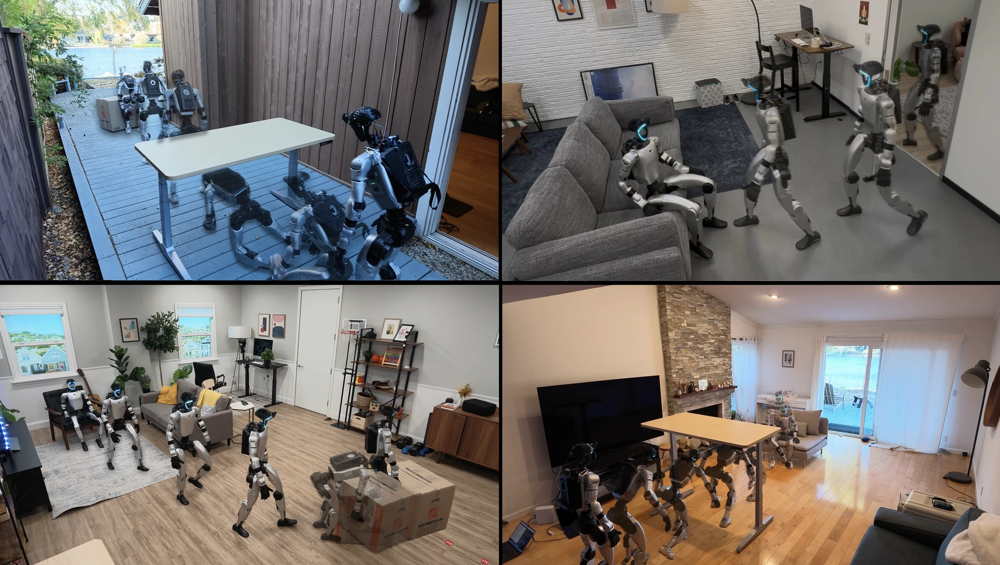

# HALO: Perceptive Humanoid Motion from Simulation

[](https://apple-aiml-research.github.io/ml-halo/)
[](https://arxiv.org/)

<!-- TODO(release): authors. -->

This repository contains the code for data generation, model training, and
deployment from the HALO paper.

<!-- TODO(release): confirm scope vs. the paper. No tracker weights ship; the
     proprio and depth tracker students are trained with tracker/training. -->



## Repository layout

| Folder | What it is | Docs |
|---|---|---|
| [`datagen/`](datagen/) | Synthetic data pipeline: Infinigen scenes, Kimodo motion, Isaac / MuJoCo rendering; training data for the generator (rendered episodes) and the tracker (motion clips) | [README](datagen/README.md) |
| [`generator/`](generator/) | Motion generator: training and open-loop evaluation | [README](generator/README.md) |
| [`tracker/`](tracker/) | G1 motion-tracking policy: Isaac Lab training, Python and C++ (real-time) deployment | [README](tracker/README.md) |
| [`orchestrator/`](orchestrator/) | `halo_orchestrator`: the orchestrator (language request + egocentric image → plan of subtasks) on a local model co-served with the generator | [README](orchestrator/README.md) |
| [`system/`](system/) | Closed-loop system: `run_sim.py` / `run_real.py` launchers, generator / tracker / orchestrator nodes, live web viewer; `system/comm` (`halo_comm` messaging) and `system/serve` (`halo_serve`, on-device model scheduling) | [README](system/README.md) |
| [`assets/`](assets/) | Unitree G1 robot description (MJCF / URDF / USD), scene objects and scenes | [robots](assets/robots/README.md), [objects](assets/objects/README.md) |

## Data generation

To generate the training data, rendered episodes for the generator and motion clips for the tracker, see
[`datagen/README.md`](datagen/README.md).

## Training

- **Generator:** [`generator/README.md`](generator/README.md), which covers setup and
  single- / multi-node training.
- **Tracker:** [`tracker/training/README.md`](tracker/training/README.md), which
  covers Isaac Lab and the three training phases: privileged experts (`PreRL` tasks) → multi-teacher distillation
  → multi-critic fine-tuning (`PostRL` tasks).

## Deployment

The orchestrator runs a local model on the generator's `halo_serve` engine; see
[`orchestrator/README.md`](orchestrator/README.md#model).

- **Tracker on its own (MuJoCo sim-to-sim, real robot):** [`tracker/deploy/README.md`](tracker/deploy/README.md)
  (Python) and [`tracker/deploy_cpp/README.md`](tracker/deploy_cpp/README.md) (real-time C++)
- **Closed-loop in sim (MuJoCo):** [`system/README.md`](system/README.md#run-sim) (`run_sim.py`)
- **Closed-loop on the real robot (G1):** [`system/README.md`](system/README.md#run-real) (`run_real.py`)

## Citation

If you find this work useful, please cite:

```bibtex
@article{halo2026,
  title     = {Perceptive Humanoid Motion from Simulation},
  author    = {Hu, Siyuan and Abuduweili, Abulikemu and Meng, Yue and Liu, Shipeng and Leboutet, Quentin and
               Chen, Chen and M{\"u}ller, Matthias and Koltun, Vladlen},
  journal   = {arXiv preprint},
  year      = {2026}
}
```

## License

Please check out the repository [LICENSE](LICENSE) before using the provided code.

<!-- TODO(release): license. Third-party assets (e.g. the Unitree G1 robot
     description) keep their original licenses. -->
