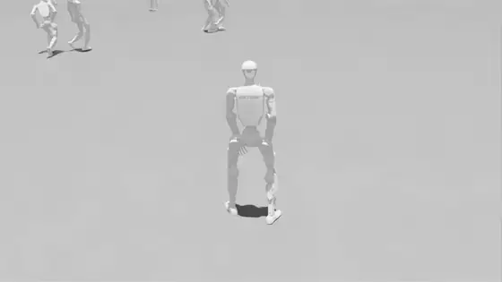
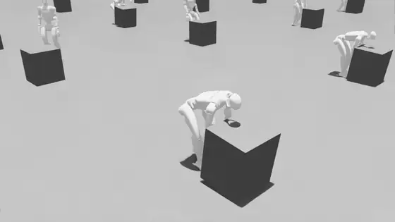
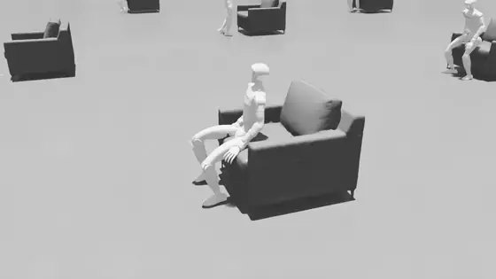
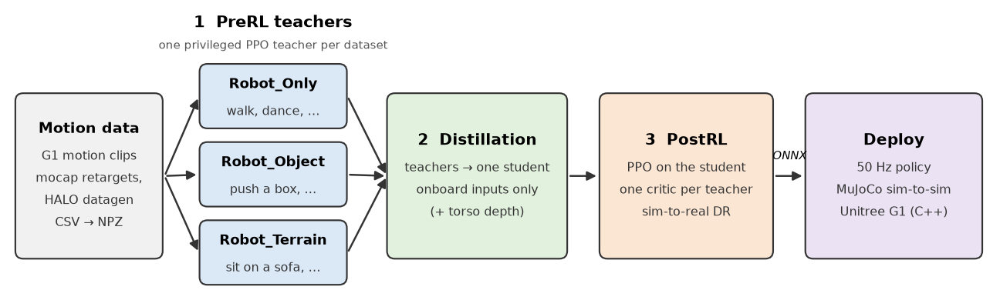

# HALO tracker

**Perceptive whole-body motion tracking for the Unitree G1.** The tracker takes a motion plan from HALO's motion
generator, together with the robot's proprioception, IMU and (optionally) an egocentric depth image, and outputs joint
position targets at 50 Hz that a PD controller executes. This folder trains it in Isaac Lab and deploys it in MuJoCo and
on the real robot.

<table>
  <tr>
    <td align="center"><br><sub>free motion (Isaac Lab)</sub></td>
    <td align="center"><br><sub>push a box (Isaac Lab)</sub></td>
    <td align="center"><br><sub>sit on a sofa (Isaac Lab)</sub></td>
  </tr>
</table>

## How it is trained



1. **Privileged experts (PreRL).** One PPO expert per motion dataset, with the task of the dataset's type:
   `Robot_Only` (free motion), `Robot_Object` (pushing a box) or `Robot_Terrain` (sitting on a sofa). Experts see the
   full simulator state and a height map of the terrain and objects around them.
2. **Multi-teacher distillation.** On-policy DAgger into one student that gets only what the robot has onboard:
   proprioception, the IMU, the motion plan and, for the depth student, a 48×84 torso depth image.
3. **Multi-critic fine-tuning (PostRL).** PPO on the student with one critic per teacher, and wider domain
   randomization around the identified robot.

Every phase trains on a system-identified model of the lab G1. Details and every command:
[training/README.md](training/README.md).

## Contents

| Folder | What it is |
|---|---|
| [`training/`](training/README.md) | Isaac Lab tasks, the three training phases, export to ONNX |
| [`data/`](data/README.md) | CSV → NPZ motion conversion (retargeted mocap, HALO datagen episodes) and a viewer |
| [`deploy/`](deploy/README.md) | Python deployment: MuJoCo sim-to-sim and the real robot |
| [`deploy_cpp/`](deploy_cpp/README.md) | Real-time C++ deployment on the G1's Jetson Orin NX (TensorRT, D435i stereo depth) |

Robot and scene assets (the G1 models, the push box and the lab sofa) live in [`assets/`](../assets). No datasets or
policy weights ship with the repository. The HALO datagen pipeline produces sit-on-sofa clips; free-motion clips come
from retargeted mocap (e.g. LAFAN1); push-box clips also need the box trajectory, which no tool here produces.

## Policies

Training exports two students; each has one deploy config per deployment, with identical settings:

| Student | ONNX inputs → output | Python config | C++ config |
|---|---|---|---|
| proprio | `obs` (1, 434), `policy_temporal` (1, 30, 166) → `actions` (1, 29) | `deploy/g1/configs/g1_v2.yaml` | `deploy_cpp/configs/g1_v2.yaml` |
| depth | the above + `student_depth` (1, 1, 48, 84) | `deploy/g1/configs/g1_v2_depth.yaml` | `deploy_cpp/configs/g1_v2_depth.yaml` |

`obs` is proprioception, the IMU, the last action and the current and next 4 frames of the motion plan;
`policy_temporal` is the 30-frame history; `student_depth` is the torso camera's z-depth (clipped to 0.2–2.5 m,
log1p-encoded). Both deployments enter control only once robot state, odometry and (depth student) a depth frame are
live, latch damping on stale or non-finite state, refuse non-finite plans and swap plans atomically
([deploy/README.md](deploy/README.md#real-robot), [deploy_cpp/README.md](deploy_cpp/README.md)).

## Quick start

All commands run from `tracker/`.

The input data are G1 joint-space motion clips (CSV, 30 fps, root pose + 29 joint angles), which
`data/scripts/batch_process.py` replays in Isaac Lab into the NPZ clips training reads. Two sources: retargeted mocap,
e.g. the Unitree-retargeted LAFAN1 clips, and HALO datagen episodes ([`datagen/`](../datagen/README.md)), which
`data/scripts/datagen_to_csv.py` turns into sit clips bound to the lab sofa. Each dataset gets its own folder under
`data/g1_processed/robot_only/`, `robot-object/` or `robot-terrain/`, and one Phase 1 expert (`PreRL` task)
([data/README.md](data/README.md), [training/README.md](training/README.md#motion-data)).

```bash
# 1. install (Isaac Lab 2.3.2 / Isaac Sim 5.1, Python 3.11; see training/README.md)
pip install "rsl-rl-lib>=5.5.1,<5.6" && pip install -e training/source/halo_tracker

# 2. CSVs -> NPZ clips, one folder per dataset: retargeted LAFAN1 (Hugging Face lvhaidong/LAFAN1_Retargeting_Dataset,
#    g1/), and HALO datagen sit episodes via datagen_to_csv.py, whose --specs is a local folder: copy datagen's motion
#    specs to the local disk first (halo_s3 copies from an s3:// or a local HALO_S3_ROOT)
python -c "from huggingface_hub import snapshot_download as d; d('lvhaidong/LAFAN1_Retargeting_Dataset', \
    repo_type='dataset', allow_patterns=['g1/*'], local_dir='data/lafan1')"
python data/scripts/batch_process.py --input-dir data/lafan1/g1 --output-dir data/g1_processed/robot_only/lafan --headless
../datagen/launch/halo_s3 sync $HALO_S3_ROOT/halo_sit_n50k/specs data/datagen_specs
python data/scripts/datagen_to_csv.py --specs data/datagen_specs --accepted_only --out data/datagen_csv/labsofa
python data/scripts/batch_process.py --input-dir data/datagen_csv/labsofa \
    --output-dir data/g1_processed/robot-terrain/labsofa --headless

# 3. train one expert per dataset with its task type (Robot_Only / Robot_Object / Robot_Terrain), register them, then
#    distill and fine-tune (training/README.md has all three phases; without push-box clips, delete the registry's
#    object_pushbox entry and leave its folder out)
python training/scripts/rsl_rl/train.py --task Halo-MotionTracking-Robot_Only-PreRL --headless \
    --motion_data_folder data/g1_processed/robot_only/lafan --run_name lafan
python training/scripts/rsl_rl/train.py --task Halo-MotionTracking-Robot_Terrain-PreRL --headless \
    --motion_data_folder data/g1_processed/robot-terrain/labsofa --run_name labsofa

# 4. export the student to ONNX (<checkpoint dir>/exported/policy.onnx)
python training/scripts/rsl_rl/play.py --task Halo-MotionTracking-PostRL-ProprioDepth-Play --export_only \
    --checkpoint <PostRL model_*.pt> --teacher_registry_yaml training/configs/teacher_registry_scene.yaml \
    --motion_data_folder data/g1_processed/robot_only data/g1_processed/robot-terrain/labsofa

# 5. sim-to-sim in MuJoCo (on macOS run the viewer with mjpython; without a display add --headless, and for the depth
#    student also export MUJOCO_GL=egl so its camera renders; ".[deploy,depth]" adds the RealSense camera).
#    --policy_path and --motion are relative to deploy/g1; the scene is flat ground, so play free-motion clips
pip install -e ".[deploy]"
cd deploy/g1 && python deploy_mujoco.py --config configs/g1_v2_depth.yaml \
    --policy_path ../../logs/rsl_rl/motion_tracking_scene_postrl_proprio_depth/<run>/exported/policy.onnx \
    --motion ../../data/lafan1/g1/walk1_subject1.csv
```

On the robot the tracker runs as a C++ real-time process on the G1's Jetson Orin NX (PREEMPT_RT, lock-free triple
buffers, TensorRT); the depth student reads the D435i's raw IR stereo pair through a TensorRT LiteAnyStereo model
whose engine is built on the robot first ([deploy_cpp/docs/depth.md](deploy_cpp/docs/depth.md)):

```bash
cd deploy_cpp
# the stock G1 (JetPack 5): gcc-10 and the robot's Unitree SDK; cmake >= 3.22 and the conda flags: deploy_cpp/README.md
export UNITREE_SDK2_ROOT=/opt/unitree_robotics
CC=gcc-10 CXX=g++-10 cmake --preset release-rt-orin -DRT_DEPLOY_WITH_TRT=ON -DRT_DEPLOY_WITH_UNITREE=ON \
    -DRT_DEPLOY_WITH_REALSENSE=ON
cmake --build build/release-rt-orin -j
sudo setcap 'cap_sys_nice=eip cap_ipc_lock=eip' build/release-rt-orin/deploy_g1_real   # RT priority + mlockall, no root
build/release-rt-orin/onnx_to_trt --onnx <policy.onnx> --plan policy.plan --weakly-typed --fp16
#   TensorRT 8.5 (JetPack 5, the stock G1) cannot parse the student's LayerNorm: use tools/build_onnx_to_trt.sh, which
#   decomposes it first (deploy_cpp/README.md)
build/release-rt-orin/deploy_g1_real --net eth0 --config configs/g1_v2_depth.yaml --policy policy.plan \
    --depth_config configs/depth_d435i.yaml --motion <motion.csv> --rt_prio 80 --rt_cpu 1 --lock_memory
```

The Python [`deploy/g1/deploy_real.py`](deploy/README.md) runs the same policies from a computer connected to the
robot. Motion plans streamed by the HALO motion generator at run time are served by the tracker nodes in
[`system/`](../system/README.md).
